<p align="center">
  
</p>

# 🚀 Network Infrastructure & Virtualized Services — SBN Solution Tech

> **Technical Project — BTS SIO (IT Services for Organizations) SISR Option (Session 2024–2026)**  
> *Technical documentation covering network architecture, Proxmox VE virtualisation, Active Directory, DFS replication, and enterprise service deployment.*

---

🌐 **Languages / Langues** : [English](README_EN.md) | [Français](README.md)

---

## 📋 1. Project & Enterprise Overview

**SBN Solution Tech** is a company specializing in high-end computer hardware sales and maintenance. To address organizational, security, and high-availability requirements across the Management, Repair Workshop, and Retail Store divisions, a fully virtualized, robust enterprise infrastructure was designed and deployed.

The entire environment is virtualized using **Proxmox VE** on a physical **Dell PowerEdge R730** server.

```text
                                    [ WAN / Internet Access ]
                                               |
                                     (vmbr0 - WAN Proxmox)
                                               |
                                    +---------------------+
                                    |  pfSense Firewall   | (Inter-VLAN Routing & DHCP)
                                    +---------------------+
                                               |
                                  (vmbr2 - Trunk VLAN-Aware)
                                               |
          +------------------------------------+------------------------------------+
          |                                    |                                    |
 [VLAN 10 : Management]               [VLAN 20 : Workshop]                 [VLAN 30 : Retail Store]
 192.168.10.0/24                      192.168.20.0/24                      192.168.30.0/24
  - SRV-DC01-D (Active Directory)      - Client PC-0X-A (Win 11)            - SRV-DC02-M (Replicated AD)
  - NAS OpenMediaVault (RAID 1)        - Dolibarr ERP/Samba Server          - Xibo CMS Server (Docker)
  - Mailcow Mail Server (Docker)                                            - Storefront Xibo Players
```

<p align="center">
  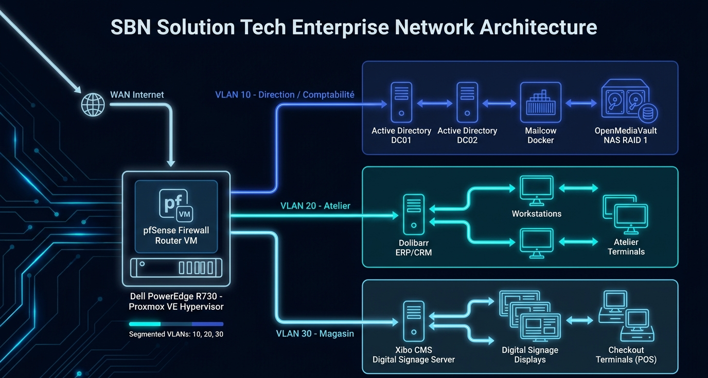
</p>

---

## 🏗️ 2. IP Addressing & Routing Table

### 2.1. VLAN Topology (802.1Q)
| VLAN | Department / Service | CIDR Network | Gateway (pfSense) | DHCP Range / Hosts | Static IP Allocations |
| :--- | :--- | :--- | :--- | :--- | :--- |
| **VLAN 10** | Management & Accounting | `192.168.10.0/24` | `192.168.10.1` | `192.168.10.10–50` | AD Controllers (`.200`), NAS (`.250`), Mail (`.12`) |
| **VLAN 20** | Repair Workshop | `192.168.20.0/24` | `192.168.20.1` | `192.168.20.10–50` | Dolibarr ERP (`.200`), PC-A Clients |
| **VLAN 30** | Store & Showroom | `192.168.30.0/24` | `192.168.30.1` | `192.168.30.10–50` | AD 2 Server (`.200`), Xibo Server (`.14`), Players |
| **VLAN 1** | Management / Admin | `192.168.1.0/24` | `192.168.1.1` | `192.168.1.10–50` | Proxmox VE (`192.168.1.X`), Dell iDRAC |

---

## 🛠️ 3. Step-by-Step Deployment Guide

### 3.1. Proxmox VE Virtualization & pfSense Routing

<p align="center">
  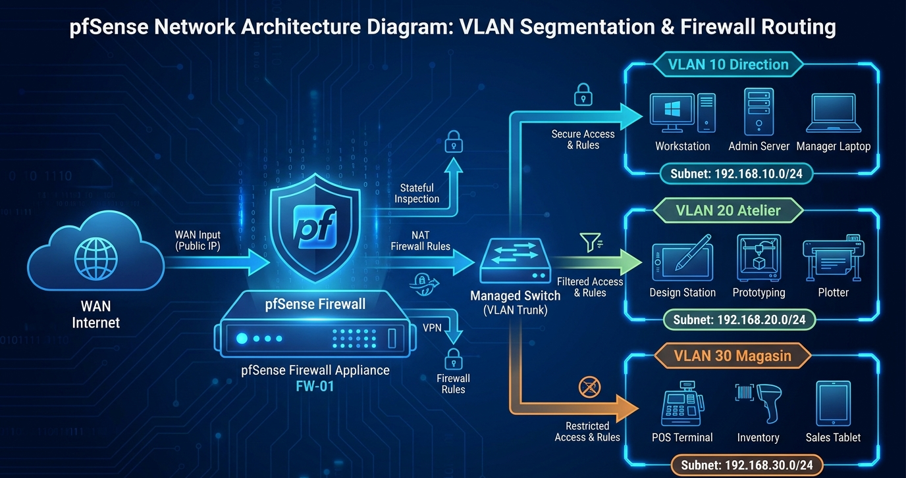
</p>

### 3.2. Active Directory, DFS & Group Policy (GPO)

<p align="center">
  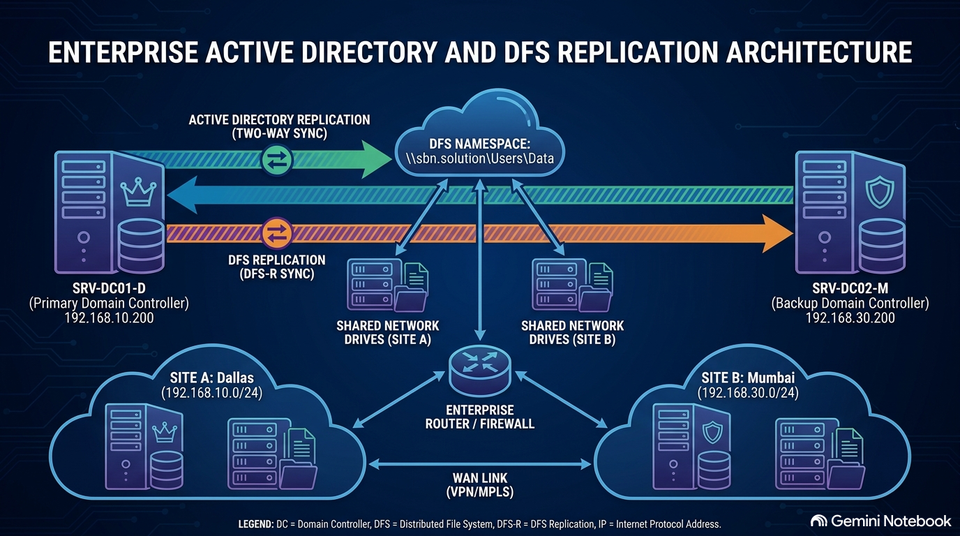
</p>

##### IP Configuration Screenshots (Side-by-side compact 700x800 format):
| SRV-DC01-D (VLAN 10 — Management) | SRV-DC02-M (VLAN 30 — Store) |
| :---: | :---: |
| 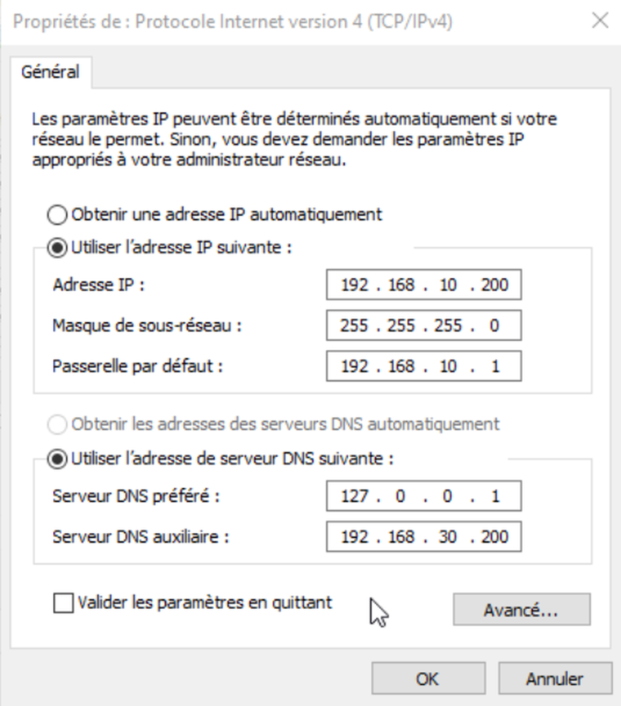 | 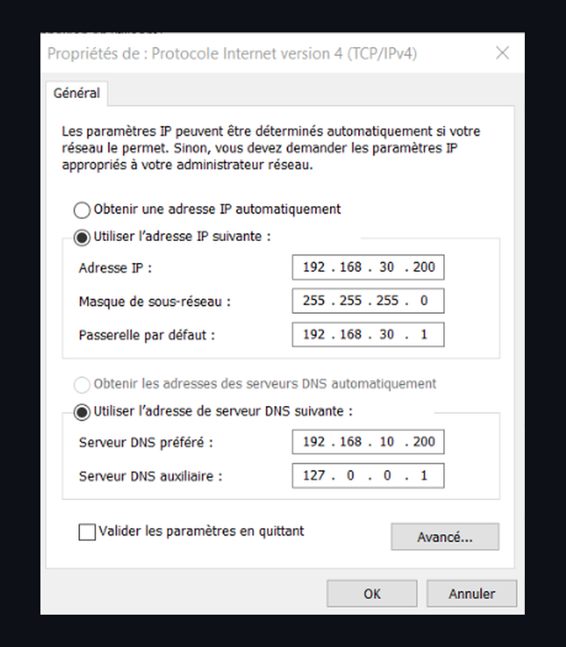 |

##### Active Directory, DNS & Groups Console:

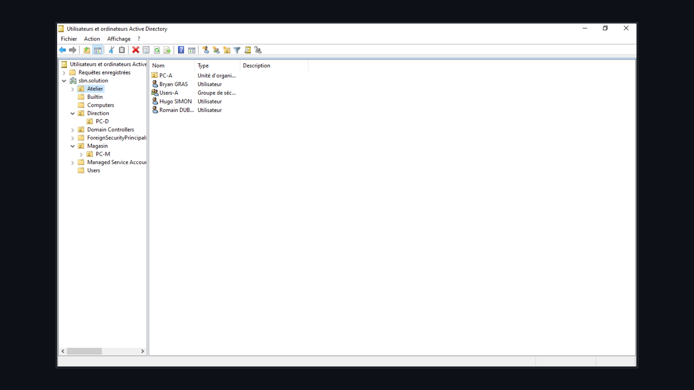

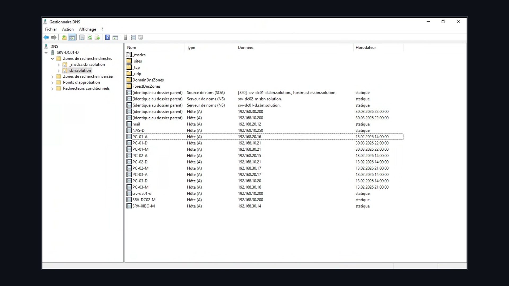

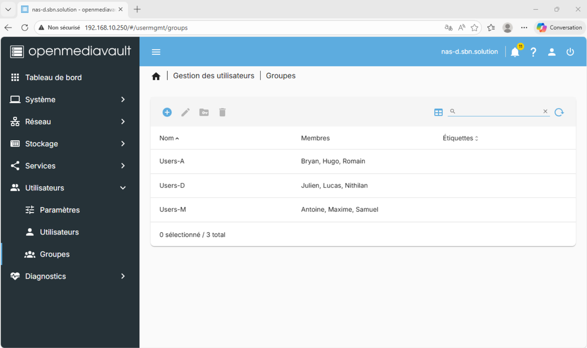

##### DFS & GPO Redirection Screenshots (Full-width vertical layout):

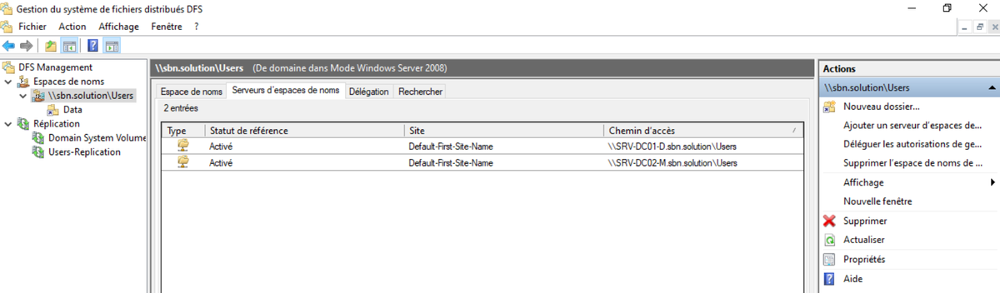

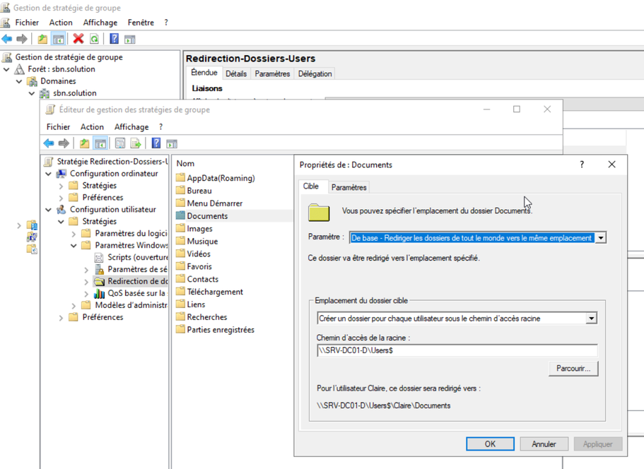

##### Department Desktop Wallpapers (GPO Wallpapers):

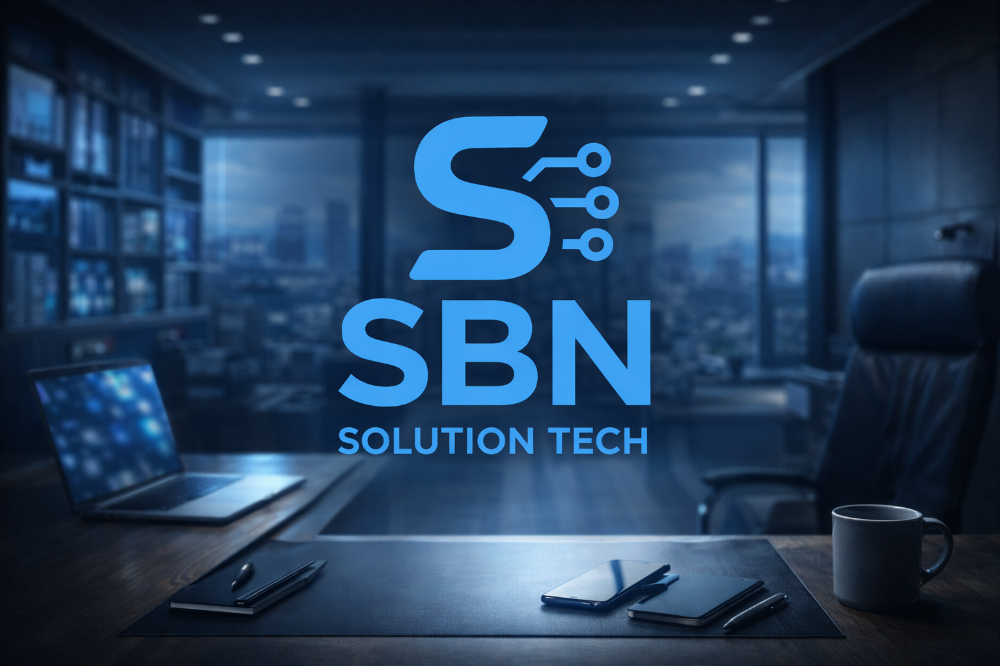

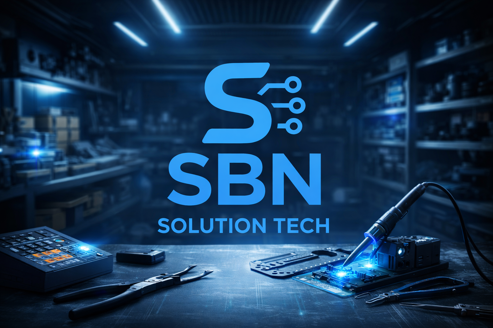

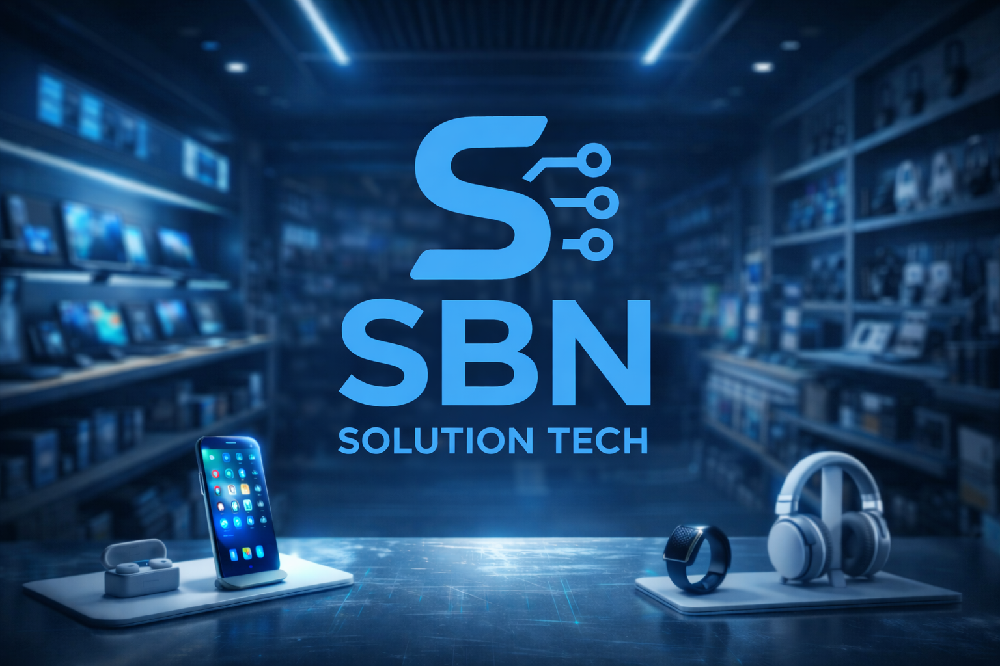

---

### 3.3. OpenMediaVault NAS (RAID 1 & SMB Shares)

<p align="center">
  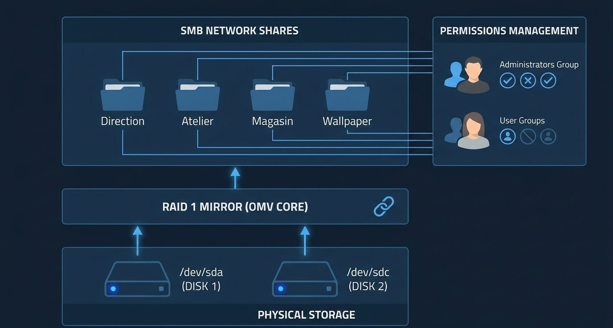
</p>

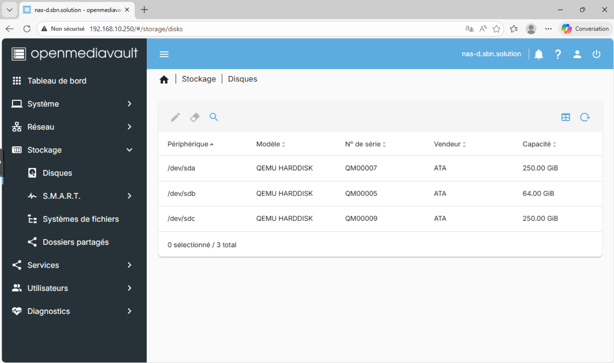

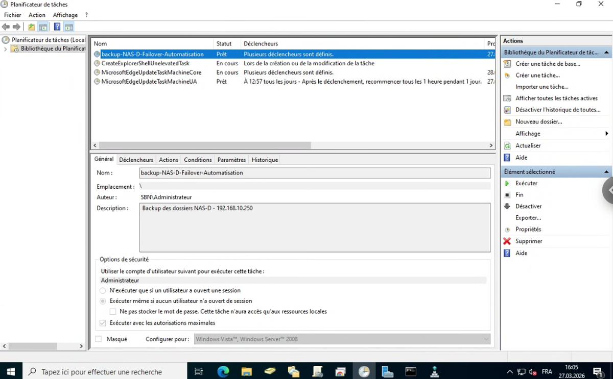

---

### 3.4. Docker Containerized Applications (Mailcow, Dolibarr, Xibo)

<p align="center">
  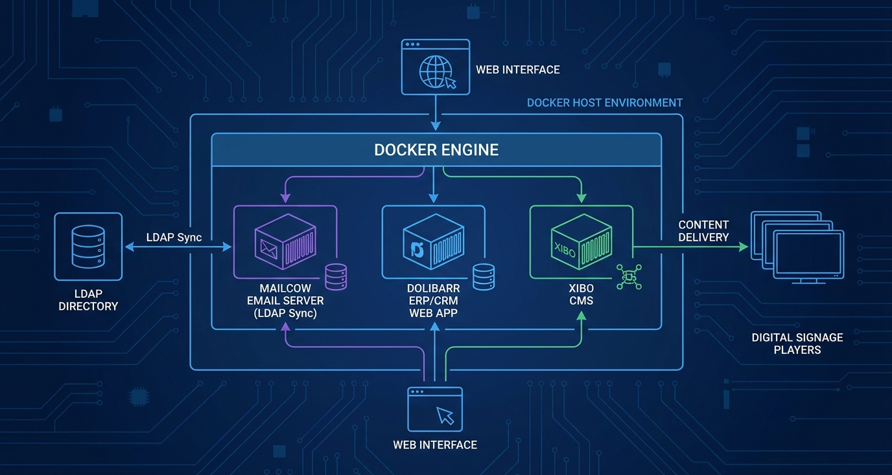
</p>


---

## 🎓 4. Academic Context & Credits

Technical Project designed and implemented by **Nithilan SHUBASKARAN** for the **BTS SIO SISR** Option (Session 2024–2026).
