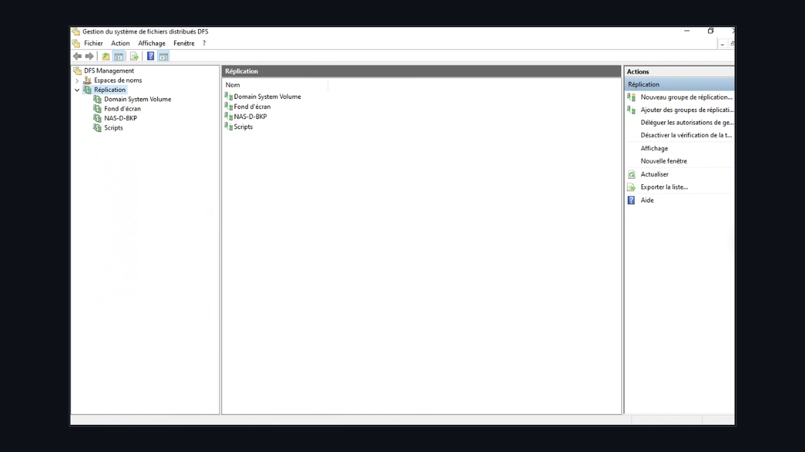
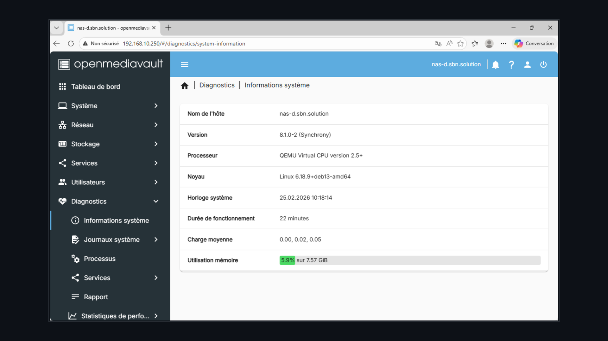
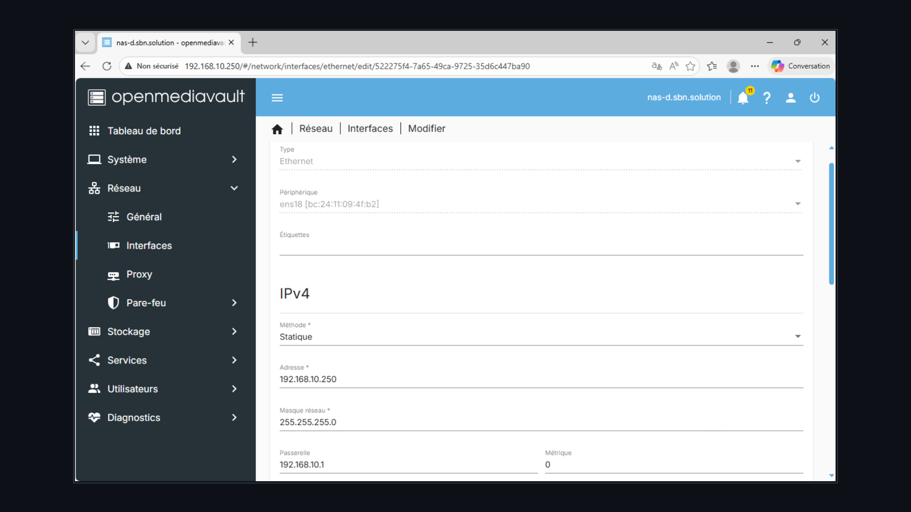
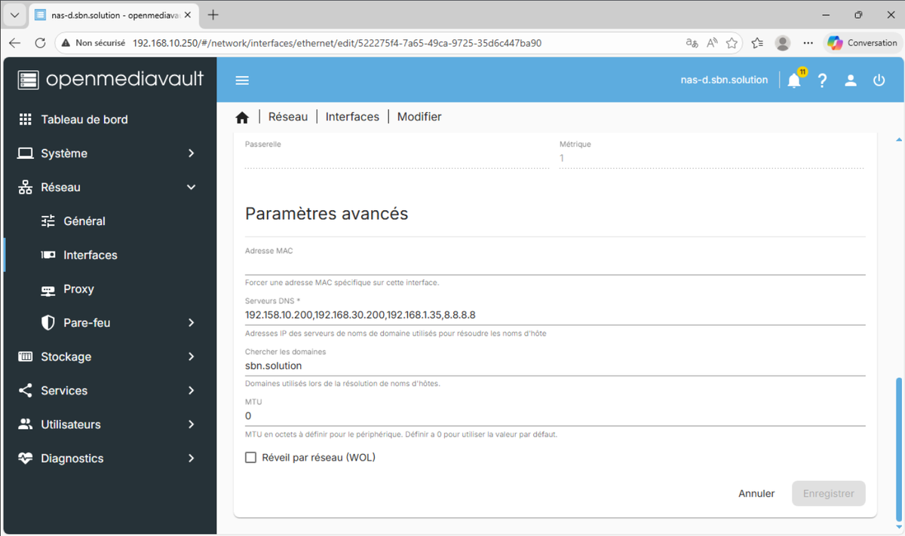
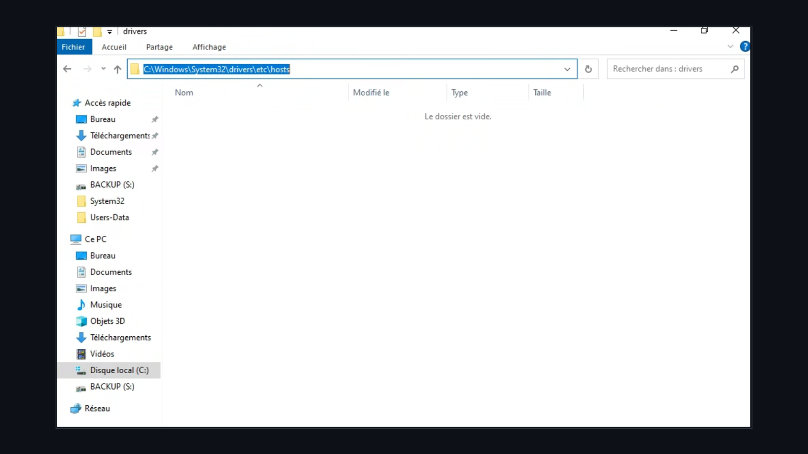
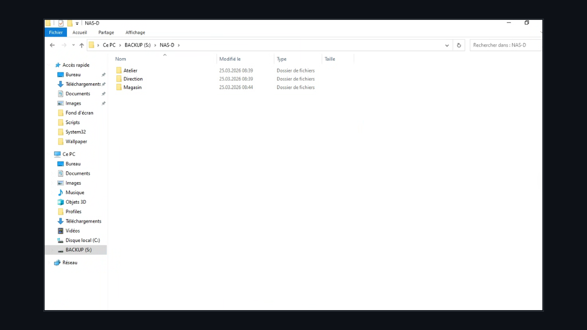
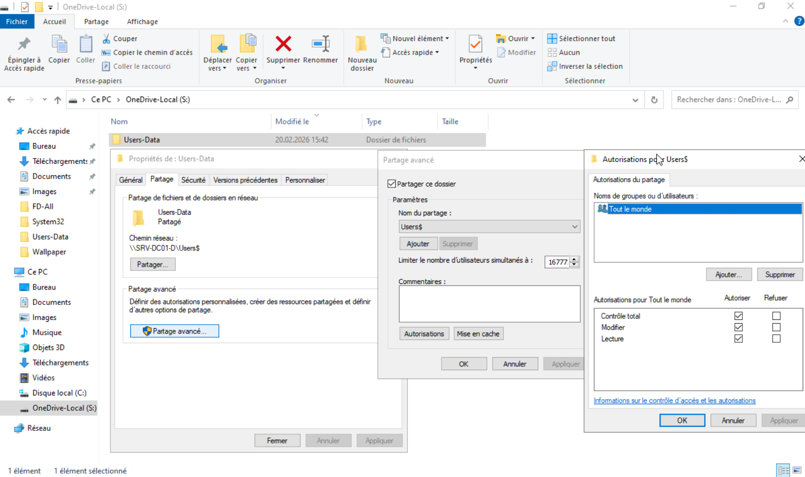

# 🚀 Enterprise Network Infrastructure & Virtual Services — SBN Solution Tech

> **Technical Exam Project — BTS SIO (IT Services for Organizations) SISR Option (2024–2026 Session)**  
> *Step-by-step deployment guide, network architectures, system configurations, security procedures, and infrastructure diagrams.*

---

🌐 **Languages / Langues** : [Français](README.md) | [English](README_EN.md)

---

## 📋 1. Project Overview

**SBN Solution Tech** is an enterprise specializing in high-performance computer sales and IT repair services. To meet corporate organizational and security requirements for Direction, Workshop, and Store divisions, a fully virtualized, segmented, and highly available IT infrastructure was engineered.

The entire environment is virtualized on a **Proxmox VE** platform running on a physical **Dell PowerEdge R730** server.

### 🏗️ Global Infrastructure Logical Diagram

---

## 🏗️ 2. IP Addressing & Network Segmentation

### 2.1. VLAN Mapping (802.1Q)
| VLAN | Role / Service | Subnet CIDR | Gateway (pfSense) | DHCP Range / Pool | Static IP Reservations |
| :--- | :--- | :--- | :--- | :--- | :--- |
| **VLAN 10** | Direction & Accounting | `192.168.10.0/24` | `192.168.10.1` | `192.168.10.10–50` | AD Servers (`.200`), NAS (`.250`), Mail (`.12`) |
| **VLAN 20** | Repair Workshop | `192.168.20.0/24` | `192.168.20.1` | `192.168.20.10–50` | Dolibarr ERP Server (`.200`), PC-A Workstations |
| **VLAN 30** | Retail Store & Display | `192.168.30.0/24` | `192.168.30.1` | `192.168.30.10–50` | AD Server 2 (`.200`), Xibo Server (`.14`), Players |
| **VLAN 1** | Management / Admin | `192.168.1.0/24` | `192.168.1.1` | `192.168.1.10–50` | Proxmox VE (`192.168.1.X`), Dell iDRAC |

### 2.2. Servers & Infrastructure Equipment Table
| Hostname | OS | IP Address | Deployed Roles & Services |
| :--- | :--- | :--- | :--- |
| `SRV-DC01-D` | Windows Server 2022 | `192.168.10.200` | Primary Domain Controller, DNS, DFS Root |
| `SRV-DC02-M` | Windows Server 2022 | `192.168.30.200` | Secondary Domain Controller, AD & DFS Replication |
| `NAS-D` | OpenMediaVault 8.1 / Debian | `192.168.10.250` | RAID 1 NAS Storage, SMB Shares, OMV-Extras |
| `MAILCOW` | Ubuntu Server 22.04 / Docker | `192.168.20.12` | Mailcow Suite (SMTP/IMAP/SOGo) + LDAP Sync |
| `Dolibarr` | Debian / Apache / MariaDB | `192.168.20.200` | Commercial ERP / CRM + Samba File Server |
| `SRV-XIBO-M` | Ubuntu Server 22.04 / Docker | `192.168.30.14` | Xibo CMS Digital Signage Server & SFTP |
| `Player-XIBO0X` | Windows 11 Pro | DHCP (VLAN 30) | Window Store Display Monitors with Xibo Player |

---

## 🛠️ 3. Component Deployment & Configurations

### 3.1. Virtualization (Proxmox VE) & Routing (pfSense)

---

### 3.2. Active Directory, DNS Service & DFS Synchronization

#### A. Domain Controller Network Setup (IPv4 & DNS)

#### B. Active Directory Management Console (Users, Groups & OUs)

#### C. DFS Namespace & Server Replication

#### D. Group Policies (GPO) & Folder Redirection

---

### 3.3. Centralized OpenMediaVault Storage (NAS RAID 1 & SMB)

#### OpenMediaVault Validation Screenshots:

---

### 3.4. Docker Container Services (Mailcow, Dolibarr, Xibo)

---

## 💾 4. Backup Automation & Task Scheduling

---

## 🔒 5. Security & High Availability

* **Perimeter Firewalling**: Strict inter-VLAN rule enforcement on pfSense with default-deny policy.
* **Fault Tolerance**: Hardware RAID 1 disk mirroring, AD DS domain replication, and continuous DFS-R file sync.

---

## 🎓 6. Academic Framework & Credits

Project created for the **BTS Services Informatiques aux Organisations (SIO) - SISR Option** (2024–2026 Session) by **Nithilan SHUBASKARAN**.
