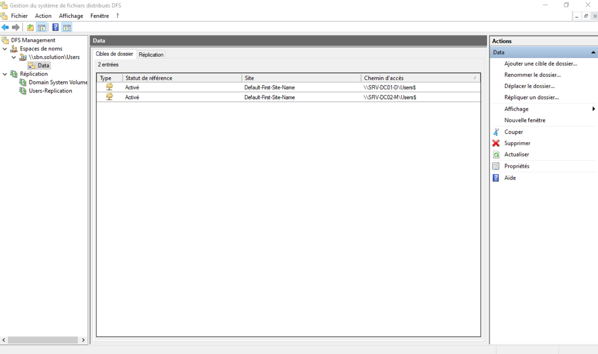
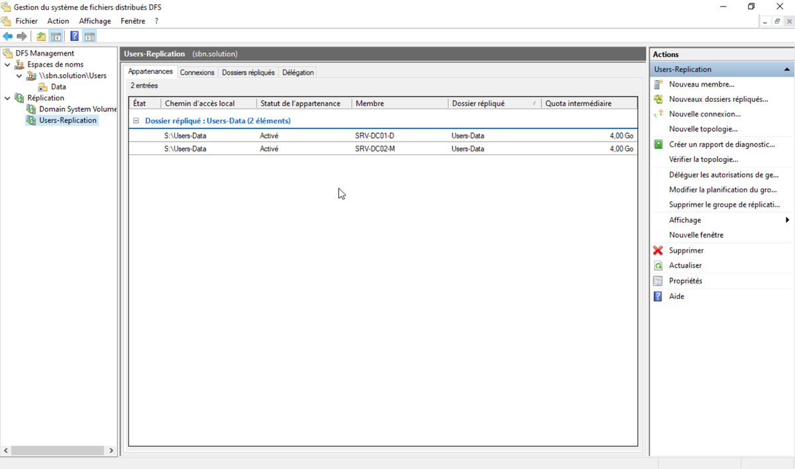
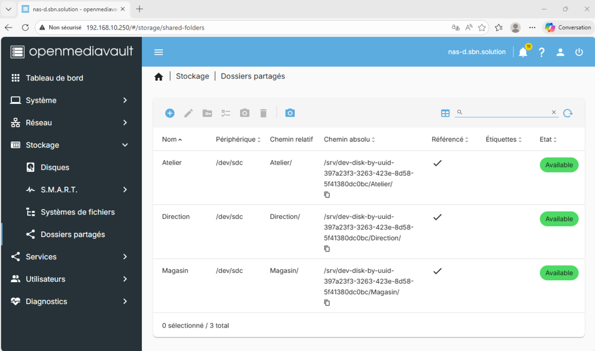
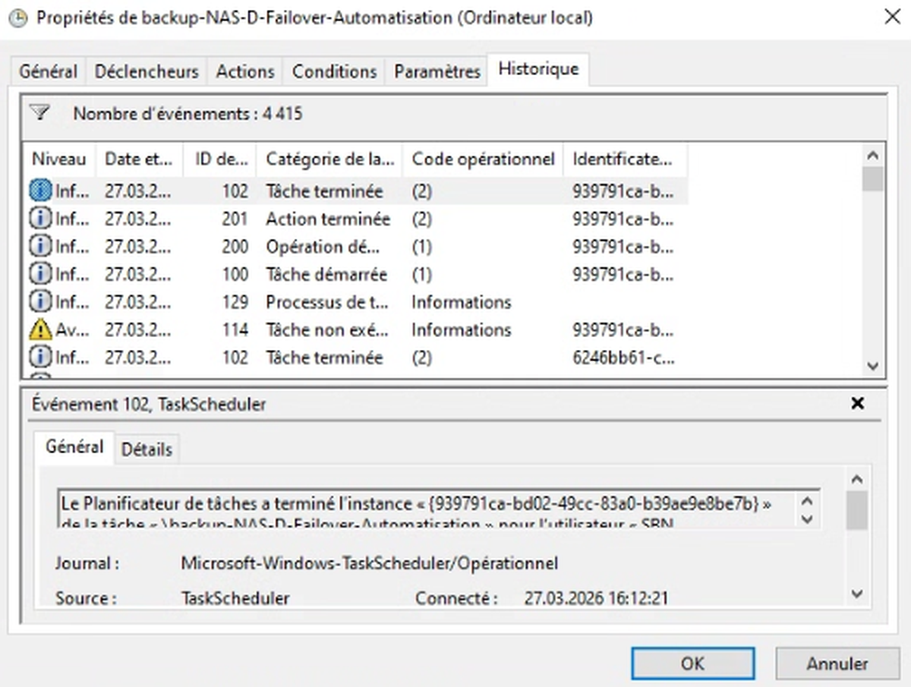

<p align="center">
  
</p>

# 🚀 Enterprise Network & Virtualized Infrastructure — SBN Solution Tech

> **Technical Exam Project — BTS SIO (IT Services for Organizations) SISR Option (2024–2026 Session)**  
> *Technical documentation of network architecture, Proxmox VE virtualization, and enterprise service deployment.*

---

🌐 **Languages / Langues** : [Français](README.md) | [English](README_EN.md)

---

## 📋 1. Project Overview

This project aims to design, deploy, and administer a 100% virtualized, segmented, and secure enterprise IT infrastructure for **SBN Solution Tech**, a company specializing in high-performance computer hardware sales and IT repair services.

The entire environment is hosted on a **Proxmox VE** hypervisor running on a physical **Dell PowerEdge R730** server.

```text
                                    [ WAN / Internet Access ]
                                               |
                                     (vmbr0 - WAN Proxmox)
                                               |
                                    +---------------------+
                                    |  pfSense Firewall   | (Inter-VLAN Routing & DHCP)
                                    +---------------------+
                                               |
                                  (vmbr2 - Trunk VLAN-Aware)
                                               |
          +------------------------------------+------------------------------------+
          |                                    |                                    |
 [VLAN 10 : Direction]                [VLAN 20 : Workshop]                 [VLAN 30 : Store]
 192.168.10.0/24                      192.168.20.0/24                      192.168.30.0/24
  - SRV-DC01-D (Active Directory)      - Client PC-0X-A (Win 11)            - SRV-DC02-M (Replicated AD)
  - NAS OpenMediaVault (RAID 1)        - Dolibarr ERP Server (Samba)        - Xibo CMS Server (Docker)
  - Mailcow Mail Server (Docker)                                            - Xibo Display Players
```


---

## 🏗️ 2. Network Architecture & IP Addressing

### 2.1. Logical VLAN Segmentation (802.1Q)
| VLAN | Role / Service | Subnet CIDR | Gateway (pfSense) | DHCP Range / Host Pool | Static IP Reservations |
| :--- | :--- | :--- | :--- | :--- | :--- |
| **VLAN 10** | Management / Direction | `192.168.10.0/24` | `192.168.10.1` | `192.168.10.10–50` | AD Servers (`.200`), NAS (`.250`), Mail (`.12`) |
| **VLAN 20** | Repair Workshop | `192.168.20.0/24` | `192.168.20.1` | `192.168.20.10–50` | Dolibarr ERP (`.200`), PC-A Workstations |
| **VLAN 30** | Retail Store & Display | `192.168.30.0/24` | `192.168.30.1` | `192.168.30.10–50` | Secondary AD (`.200`), Xibo Server (`.14`), Players |
| **VLAN 1** | Management / Admin | `192.168.1.0/24` | `192.168.1.1` | `192.168.1.10–50` | Proxmox VE (`192.168.1.X`), Dell iDRAC |

### 2.2. Servers & Infrastructure Equipment
| Hostname | OS | IP Address | Services & Roles |
| :--- | :--- | :--- | :--- |
| `SRV-DC01-D` | Windows Server 2022 | `192.168.10.200` | Primary Domain Controller, DNS, DFS Root |
| `SRV-DC02-M` | Windows Server 2022 | `192.168.30.200` | Secondary Domain Controller, AD & DFS Replication |
| `NAS-D` | OpenMediaVault 8.1 / Debian | `192.168.10.250` | RAID 1 NAS Storage, SMB Shares, OMV-Extras |
| `MAILCOW` | Ubuntu Server 22.04 / Docker | `192.168.20.12` | Mailcow Suite (SMTP/IMAP/SOGo) + LDAP Sync |
| `Dolibarr` | Debian / Apache / MariaDB | `192.168.20.200` | Commercial ERP / CRM + Samba File Server |
| `SRV-XIBO-M` | Ubuntu Server 22.04 / Docker | `192.168.30.14` | Xibo CMS Digital Signage Server & SFTP |
| `Player-XIBO0X` | Windows 11 Pro | DHCP (VLAN 30) | Display Monitors running Xibo Player |

---

## 🛠️ 3. Detailed Component Deployment & Step-by-Step Configuration

### 3.1. Virtualization (Proxmox VE) & Firewalling (pfSense)


#### Step A: Network Bridges Setup in Proxmox VE
1. Access Proxmox Web GUI (`https://192.168.1.X:8006`).
2. Navigate to **Datacenter** > **Proxmox Node** > **System** > **Network**.
3. Keep `vmbr0` attached to the physical interface `enp4s0` (WAN).
4. Create Linux Bridge **`vmbr1`** for administration.
5. Create main trunk bridge **`vmbr2`** (Name: `LAN_VLANs`, check **VLAN aware**).
6. Click **Apply Configuration**.

#### Step B: pfSense Configuration & Inter-VLAN Routing
1. Assign virtual interfaces to pfSense VM:
   * `em0` / `vtnet0` -> `vmbr0` (WAN)
   * `em1` / `vtnet1` -> `vmbr1` (LAN Admin - `10.0.0.1/30`)
   * `em2` / `vtnet2` -> `vmbr2` (LAN Trunk VLANs)
2. In pfSense (**Interfaces** > **VLANs**), add sub-interfaces on `em2`:
   * Tag `10` -> `VLAN10` (`192.168.10.1/24`)
   * Tag `20` -> `VLAN20` (`192.168.20.1/24`)
   * Tag `30` -> `VLAN30` (`192.168.30.1/24`)
3. **Firewall Rules**:
   * Block inter-VLAN traffic by default.
   * Explicitly allow AD traffic between VLAN 10 and 30 (`LDAP 389/636`, `Kerberos 88`, `RPC 135`, `DNS 53`).

---

### 3.2. Active Directory Domain Services, DFS & Group Policies (GPO)


#### Step A: Domain Controllers Deployment & Replication
1. Install **AD DS** and **DNS** roles on `SRV-DC01-D` and create forest **`sbn.solution`**.
2. Join `SRV-DC02-M` to domain `sbn.solution` and promote it as replicated domain controller.


#### Step B: DFS Namespace & GPO Setup
1. **DFS (Distributed File System)**:
   * Namespace Root: `\\sbn.solution\Users`
   * Target Folder: `Data` on dedicated drive `S:` (250 GB)
   * Replication Group: `Users-Replication` synchronized between DC01 and DC02.






2. **Deployed GPOs**:
   * **Users-Folder-Redirection**: Redirects *Documents, Desktop, Pictures, Downloads* to `\\sbn.solution\Users\Data\%USERNAME%`.
   * **NAS-Mapping-A**: Maps drive `A:` (`\\NAS-D\Atelier`) for group `Users-A`.
   * **NAS-Mapping-D**: Maps drive `D:` (`\\NAS-D\Direction`) for group `Users-D`.
   * **NAS-Mapping-M**: Maps drive `M:` (`\\NAS-D\Magasin`) for group `Users-M`.

#### Step C: Corporate Wallpapers & Customization Policies (GPO Wallpapers)
To ensure a standardized graphical desktop environment across all workstations, domain Group Policies automatically deploy official branded desktop wallpapers tailored to each department (*Management*, *Repair Workshop*, *Retail Store*).


---

### 3.3. Centralized NAS Storage (OpenMediaVault RAID 1)


1. **Disk Layout**:
   * System Disk: `/dev/sdb` (64 GB).
   * RAID 1 Volume (Mirror): `/dev/sda` (250 GB) + `/dev/sdc` (250 GB) -> Volume `397a23f3-3263-423e-8d58-5f41380dc0bc`.
2. **Groups & SMB Shares**:
   * Created Groups: `Administrators`, `Users-A` (Workshop), `Users-D` (Management), `Users-M` (Store).
   * Shared Folders: `Atelier`, `Direction`, `Magasin`, `Wallpaper`.






---

### 3.4. Containerized Application Services (Mailcow, Dolibarr, Xibo)


#### A. Unified Email Suite (Mailcow Dockerized)
* **FQDN**: `mail.sbn.solution`
* **Sync cron**: AD LDAP synchronization every minute.

#### B. ERP / CRM Dolibarr
* **Stack**: LAMP (Linux Debian, Apache2, MariaDB, PHP).
* **Backup**: Automated database dumps sent to OMV NAS `NAS-D`.

#### C. Digital Signage (Xibo CMS & SFTP)
* **CMS Host**: `192.168.30.14`
* **Media Transfer**: SFTP (Port 22) via FileZilla to store displays.


---

## 🔒 Backup Strategy & Security Policies

* **Perimeter Security**: Strict inter-VLAN filtering on pfSense with default-deny policy.
* **Backup Policy**: Daily incremental exports of databases and shares to OpenMediaVault RAID 1.
* **High Availability**: Hardware fault tolerance (RAID 1), AD DS domain replication, and DFS-R sync.

---

## 🎓 Academic Framework & Credits

Project completed by **Nithilan SHUBASKARAN** as part of the **BTS Services Informatiques aux Organisations (SIO) - SISR Option** (2024–2026 Session).
